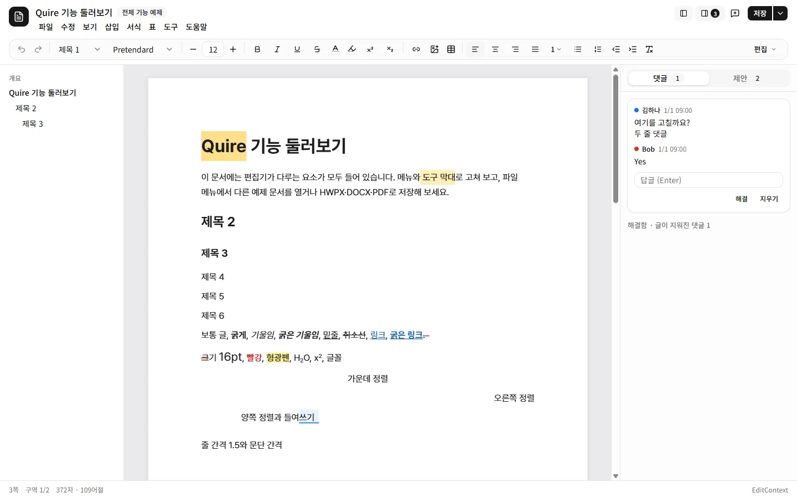
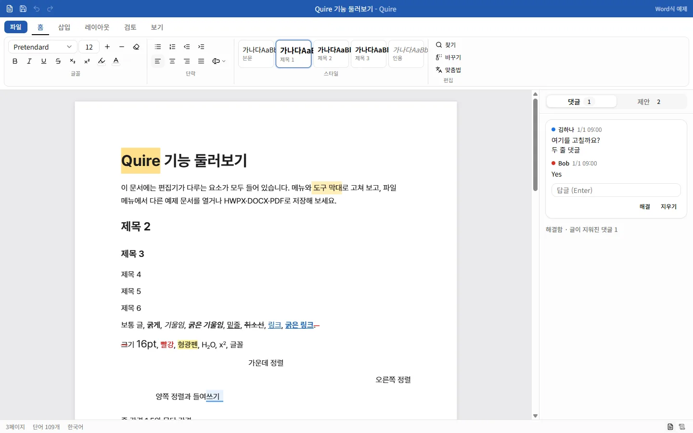
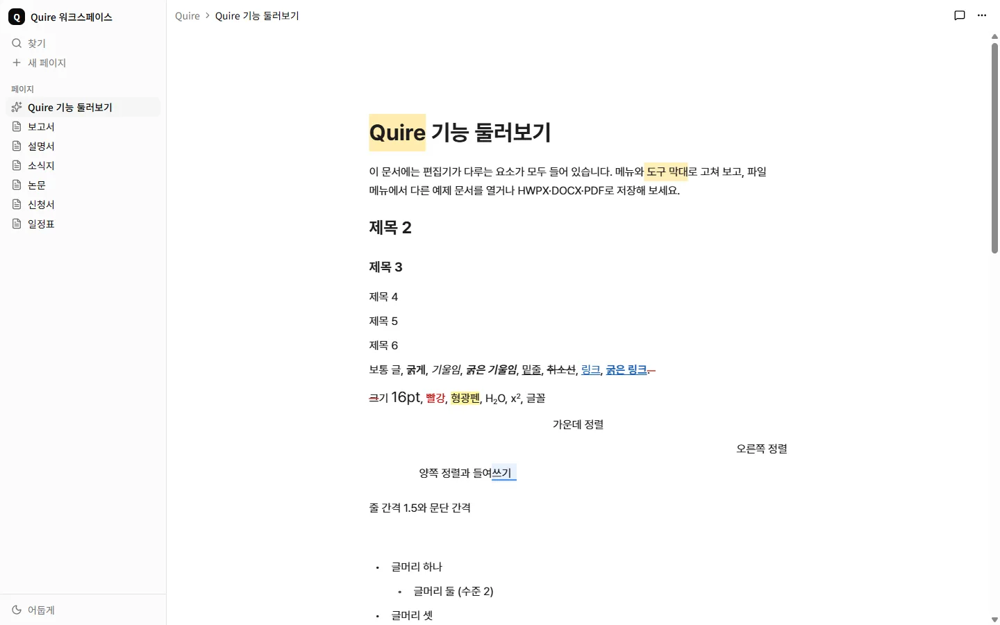
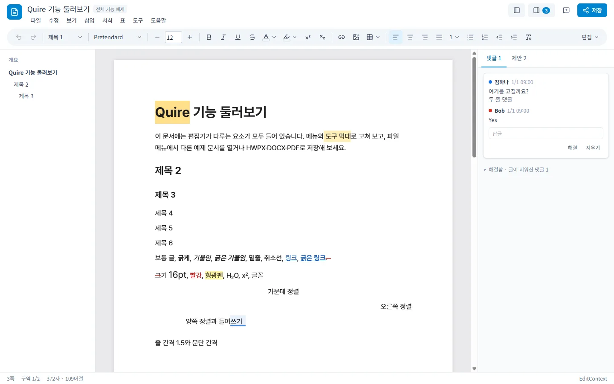
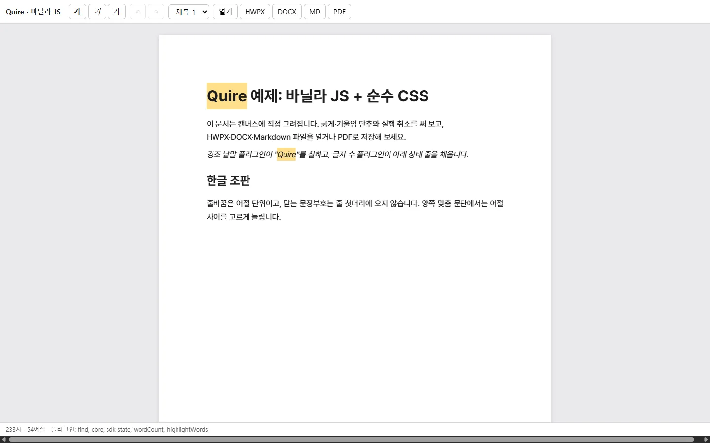
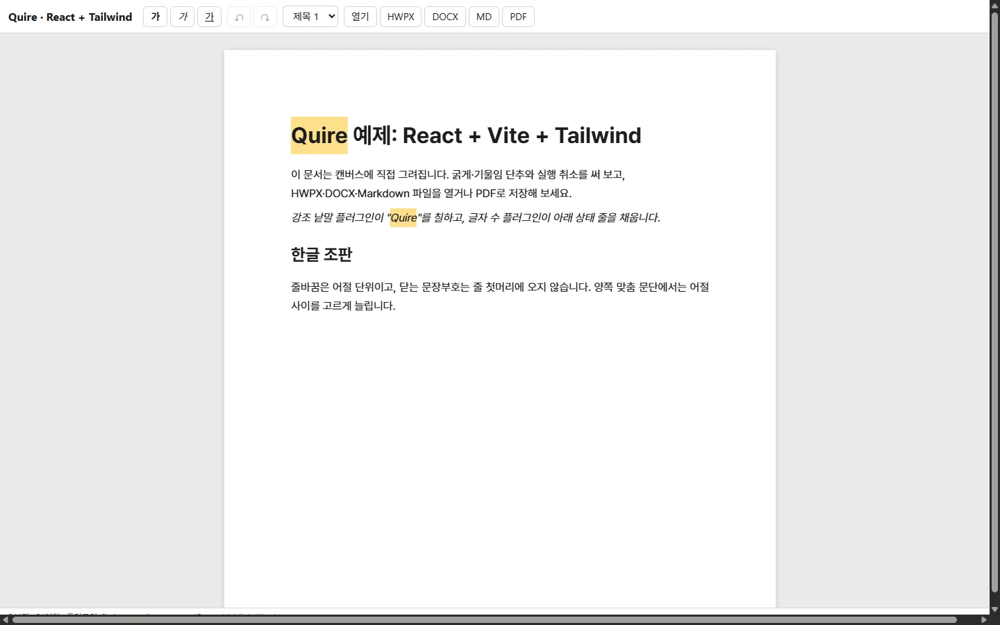
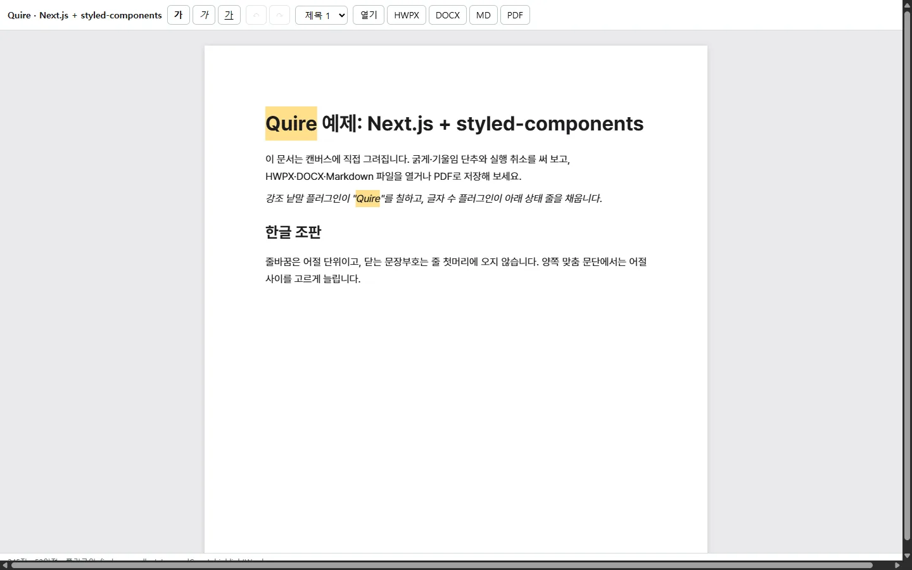
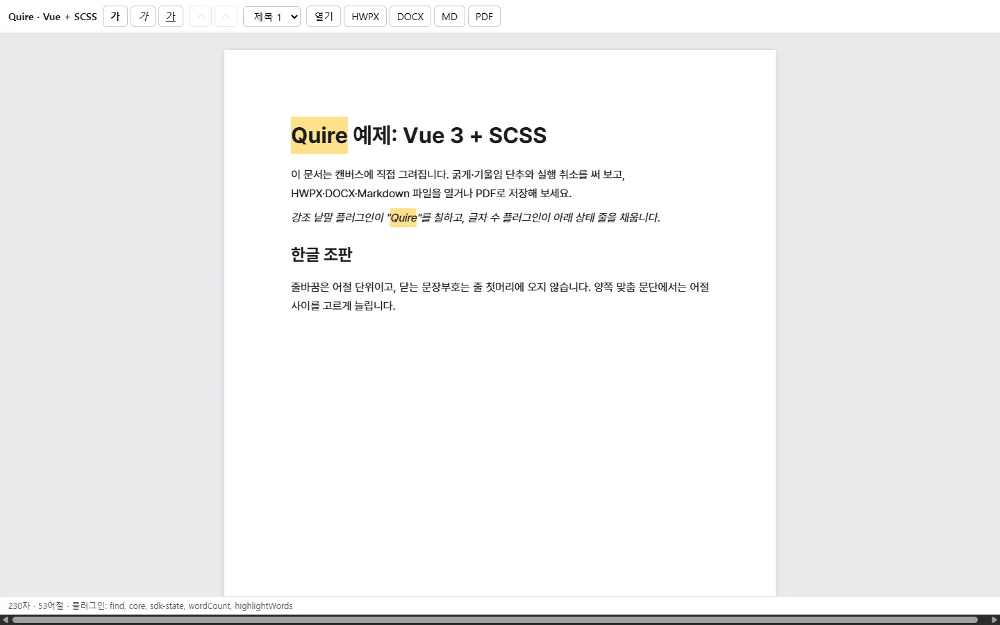
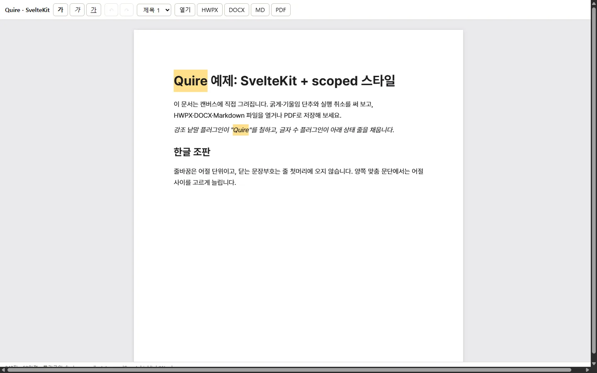

# Quire 예제 앱

저장소 **밖의 앱처럼** Quire를 쓰는 예제입니다. 워크스페이스에 들어 있지 않고, `npm pack`으로 만든 패키지(tarball)만 설치해 씁니다.

- **기본 앱 6개**: 환경마다 붙이는 법. 프레임워크 다섯 개에 CSS 방식을 하나씩 짝지어 두 축(에디터 수명주기·전역 스타일 충돌)을 덮는다 ([16 §8](../docs/design/16-release.md)).
- **전체 기능 앱 2개**: Word·Google Docs식 화면으로 편집기의 기능을 모두 보인다. 같은 기능을 두 가지 UI로.
- **스타일 예제 3개** (Next.js + Tailwind + shadcn/ui): 같은 편집기를 **Google Docs식**([next-shadcn](next-shadcn))·**Word식**([next-word](next-word))·**Notion식**([next-notion](next-notion))으로 꾸민다. 세 예제 모두 화면이 한국어·English 두 벌이다 (`?lang=en`). 편집기는 화면 틀을 정하지 않고 테마(CSS 변수)·쪽 보기·API만 준다 ([17 테마](../docs/design/17-themes.md)).

<table>
<tr>
<td width="33%"><a href="next-shadcn"></a><br><b>Google Docs식</b> · 메뉴 막대 + 한 줄 도구 막대</td>
<td width="33%"><a href="next-word"></a><br><b>Word식</b> · 리본, 인쇄 모양</td>
<td width="33%"><a href="next-notion"></a><br><b>Notion식</b> · 연속 보기, <code>/</code> 메뉴, 떠 있는 서식 막대</td>
</tr>
</table>

<table>
<tr>
<td width="50%"><a href="react-full"></a><br><b><a href="react-full">react-full</a></b> · 전체 기능, React + Tailwind</td>
<td width="50%"><a href="next-shadcn"></a><br><b><a href="next-shadcn">next-shadcn</a></b> · 전체 기능, Next.js + shadcn/ui</td>
</tr>
<tr>
<td><a href="vanilla"></a><br><b><a href="vanilla">vanilla</a></b> · HTML + JS, 순수 CSS</td>
<td><a href="react-vite"></a><br><b><a href="react-vite">react-vite</a></b> · React + Tailwind</td>
</tr>
<tr>
<td><a href="next"></a><br><b><a href="next">next</a></b> · Next.js + styled-components</td>
<td><a href="vue"></a><br><b><a href="vue">vue</a></b> · Vue 3 + SCSS</td>
</tr>
<tr>
<td><a href="svelte"></a><br><b><a href="svelte">svelte</a></b> · SvelteKit + scoped 스타일</td>
<td><a href="node"><b>node</b></a> · Node 변환기 (화면 없음): HWPX·DOCX·Markdown·HTML → PDF·HWPX·DOCX·Markdown·HTML</td>
</tr>
</table>

예제마다 README에 실행 방법, 파일 구성, 편집기를 붙이는 핵심 코드가 있습니다. 스크린샷은 `node scripts/example-screenshots.mjs [예제]`로 다시 찍습니다 (헤드리스 Chrome, 예제를 먼저 설치).

## 전체 기능 앱

| 예제 | 스택 | UI | 포트 |
|---|---|---|---|
| [react-full](react-full) | React 19 + Vite + Tailwind 4 | 직접 만든 Tailwind 컴포넌트 (Google Docs식) | 5306 |
| [next-shadcn](next-shadcn) | Next.js 16 App Router + Tailwind 4 + [shadcn/ui](https://ui.shadcn.com) (Base UI) | shadcn 컴포넌트만 (Menubar, DropdownMenu, Dialog, Select, Toggle, Popover, Tabs, ContextMenu, Tooltip, sonner …) | 5307 |
| [next-word](next-word) | Next.js 16 + Tailwind 4 + shadcn/ui | Word식: 리본(Tabs + 그룹), 파란 제목 줄, 인쇄 모양 | 5308 |
| [next-notion](next-notion) | Next.js 16 + Tailwind 4 + shadcn/ui | Notion식: 페이지 목록, 연속 보기, `/` 메뉴, 떠 있는 서식 막대, 어두운 종이 | 5309 |

담은 기능:

| 자리 | 기능 |
|---|---|
| 메뉴 막대 | 파일(새 문서, 열기 .quire·HWPX·DOCX·Markdown·HTML, 예제 문서 7개, 내려받기 6형식, 쪽 설정, 인쇄 PDF), 수정(실행 취소, 찾기·바꾸기), 보기(개요·댓글 창, 제안 표시·최종본·원본), 삽입(그림, 표, 링크, 댓글, 각주, 쪽·단·구역 나누기, 머리말·꼬리말, 쪽 번호 필드), 서식(글자, 쪽 나눔 제어, 한글 조판, 쪽 설정·다단), 표(행·열 넣고 빼기, 합치기·나누기, 제목 행 반복, 행 나누지 않기), 도구(맞춤법, 글자 수, 제안 모드·모두 수락·거부, 강조 낱말 플러그인), 도움말(단축키) |
| 도구 막대 | 실행 취소, 스타일, 글꼴, 크기, 굵게·기울임·밑줄·취소선, 글자색·형광펜, 위·아래 첨자, 링크, 그림, 표(크기 고르기), 정렬, 줄 간격, 목록, 들여쓰기, 서식 지우기, 편집/제안 모드와 보기 |
| 상황별 줄 | 표 안(행·열·합치기·배경·제목 행), 그림(배치 5가지, 대체 텍스트), 머리말·꼬리말(첫 쪽·홀짝·앞 구역과 연결, 필드), 각주 |
| 옆 창 | 개요(제목 1–3, 눌러서 이동), 댓글(달기·답글·해결·지우기)과 제안(수락·거부, 모두) |
| 그 밖 | 찾기·바꾸기(대소문자·낱말·정규식), 오른쪽 클릭(맞춤법 고칠 말, 댓글·링크, 플러그인 항목), 쪽 설정 대화상자(용지·방향·여백·다단·구역 시작·쪽 번호), 상태 줄(쪽·구역·글자·어절·모드), 단축키 Ctrl+S·P·O·Alt+M |

처음 화면은 "기능 둘러보기" 문서(제목 1–6, 글자·문단 서식, 목록, 그림, 각주, 인용, 코드, 표, 댓글·제안, 머리말·꼬리말)이고, 예제 문서 6개는 저장소의 기준 문서 세트(`fixtures/docs`: 보고서·설명서·소식지·논문·신청서·일정표)를 설치 때 공개 폴더에 복사해 쓴다 (`copy-assets.mjs --samples`).
UI가 아닌 공통 코드(화면 상태 읽기, 쪽 설정 값, 모든 형식 열기·저장, 예제 문서, 데모 맞춤법 검사기)는 [`shared/quire-app.ts`](shared/quire-app.ts)를 두 앱에 복사해 쓴다.
실시간 협업·버전 이력은 동기화 서버가 필요해 넣지 않았다 (저장소의 `apps/playground/live.html`).

shadcn 메모: shadcn CLI 4가 기본으로 Base UI 판(`base-nova`)을 깐다. CLI가 `cn`을 npm의 제3자 패키지 `cn`에서 가져오게 써서 `lib/utils.ts`를 표준대로(`clsx` + `tailwind-merge`) 고쳤고, `shadcn/tailwind.css`는 CLI 패키지를 의존성으로 두지 않으려고 `app/shadcn.css`로 복사했다. 컴포넌트를 더할 때만 `npx shadcn@4.22.2 add …`.

## 기본 앱

| 예제 | 프레임워크 | CSS | 붙이는 방법 | 포트 |
|---|---|---|---|---|
| [vanilla](vanilla) | HTML + JS (Vite) | 순수 CSS | `createEditor` (@quire/sdk) | 5301 |
| [react-vite](react-vite) | React 19 + Vite | Tailwind 4 (preflight 켬) | `useQuire`·`QuireEditor`·`useEditorState` (@quire/react) | 5302 |
| [next](next) | Next.js 16 App Router | styled-components (서버 렌더링 스타일) | @quire/react + `next/dynamic` `ssr: false` | 5303 |
| [vue](vue) | Vue 3 + Vite | SCSS | `createEditor` + 작은 컴포저블 (공식 래퍼 없음) | 5304 |
| [svelte](svelte) | SvelteKit 3 + Svelte 5 | scoped 스타일 | `onMount`에서 `createEditor` (공식 래퍼 없음) | 5305 |
| [node](node) | Node (DOM 없음) | — | `@quire/convert`·`pdfFromQuire` CLI | — |

브라우저 예제 다섯 개는 기능이 같습니다: 굵게·기울임·밑줄(상태 반영), 실행 취소·다시 실행, 문단 스타일, 예제 플러그인(글자 수, 강조 낱말),
파일 열기(HWPX·DOCX·Markdown·HTML), 저장(HWPX·DOCX·Markdown·PDF). 공통 코드는 [`shared/quire-demo.ts`](shared/quire-demo.ts)를 각 예제에 복사해 씁니다.

## 실행

```bash
# 1) 저장소 루트에서 패키지를 빌드한다 (.build/packs/*.tgz)
node scripts/build-packages.mjs

# 2) 예제마다 설치 (postinstall이 글꼴 조각과 PDF용 WASM을 공개 폴더에 복사한다)
cd examples/react-vite
npm install
npm run dev          # http://localhost:5302

cd examples/react-full && npm install && npm run dev     # 전체 기능, http://localhost:5306
cd examples/next-shadcn && npm install && npm run dev    # 전체 기능 (shadcn, Google Docs식), http://localhost:5307
cd examples/next-word && npm install && npm run dev      # Word식, http://localhost:5308
cd examples/next-notion && npm install && npm run dev    # Notion식, http://localhost:5309

# Node 변환기
cd examples/node && npm install
node convert.mjs sample.md out/sample.pdf
node convert.mjs some.hwpx out/some.docx
```

## 앱이 할 일

- **글꼴**: `@quire/fonts`의 `fonts/`(조각 + `manifest.json`)를 공개 폴더 `/quire/fonts/`에 둔다. 문서에 나온 글자가 든 조각만 내려받는다.
- **PDF**: `harfbuzzjs/dist/harfbuzz-subset.wasm`을 `/quire/harfbuzz-subset.wasm`에 둔다 (PDF 글꼴 부분화).
- 그 밖의 WASM(HarfBuzz 셰이핑, Loro)은 패키지가 알아서 찾는다. 번들러 설정이 필요 없다 (Vite는 `optimizeDeps.exclude`에 `harfbuzzjs`·`loro-crdt`).
- 서버 렌더링 프레임워크(Next.js·SvelteKit)에서는 에디터를 브라우저에서만 만든다 (`ssr: false`, `onMount`).
- 문서를 바꾼 뒤(`load`) 글자 수 플러그인은 편집할 때만 다시 세므로 `run('wordCount.report')`로 한 번 세게 한다 (전체 기능 앱).
