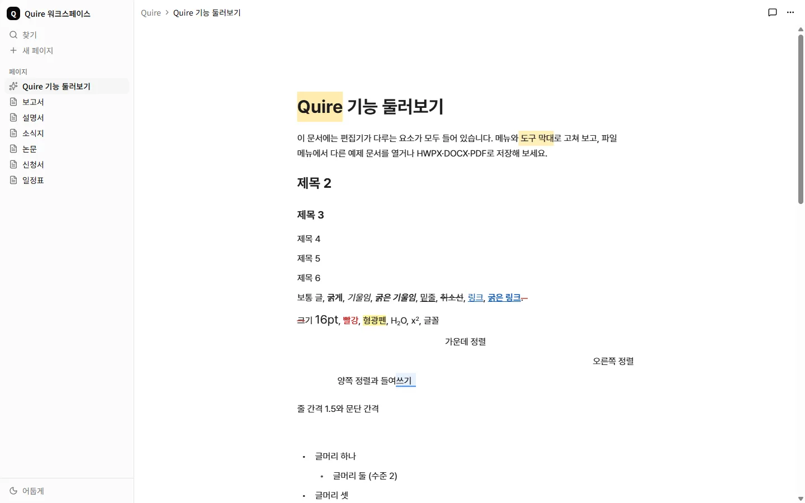
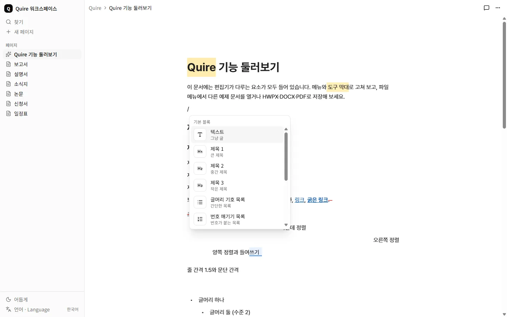
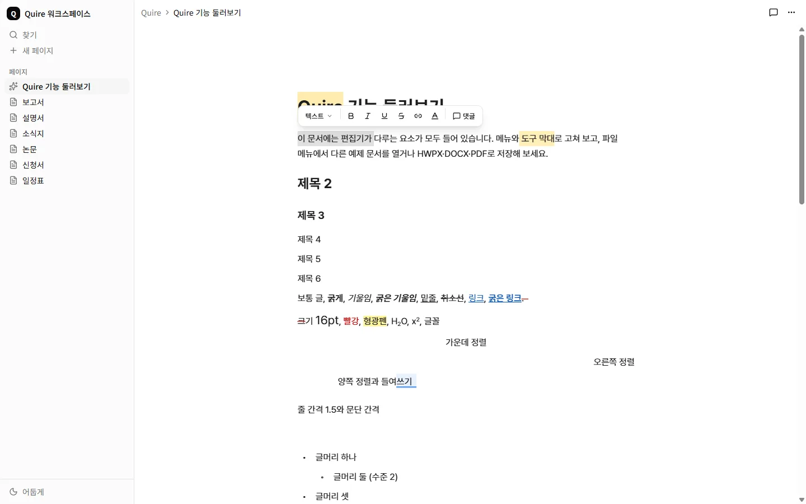
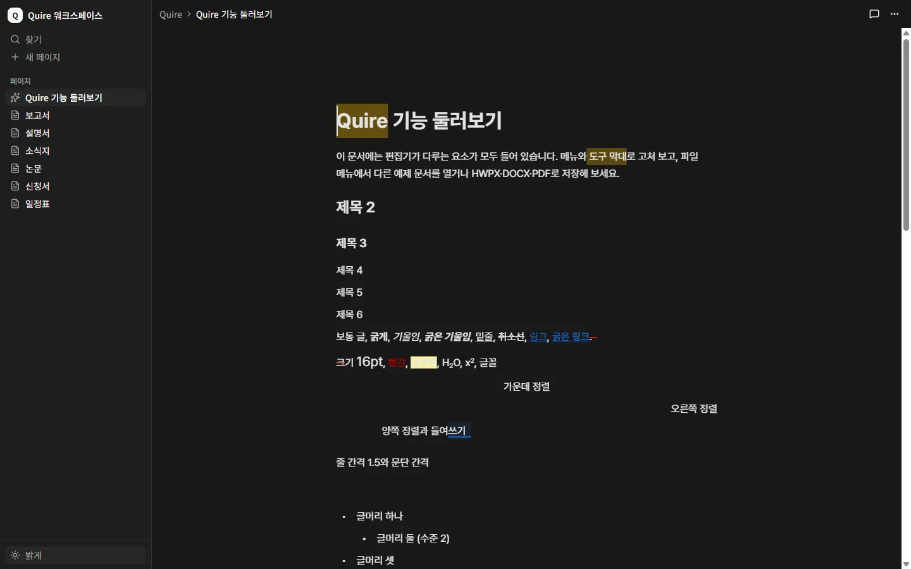

# 스타일 예제 · Notion식 (Next.js + Tailwind + shadcn/ui)

같은 Quire 편집기를 Notion식 화면으로 꾸민 예제입니다. 왼쪽 페이지 목록, 도구 막대 없이 쪽 경계가 없는 문서, 글을 고르면 뜨는 서식 막대, `/` 명령 메뉴.
같은 편집기로 만든 다른 스타일: [Google Docs식](../next-shadcn) · [Word식](../next-word).



| | |
|---|---|
|  `/` 명령 메뉴: 이어 치는 글로 거르고 ↑↓ Enter |  글을 고르면 뜨는 서식 막대 |
|  어두운 화면: 문서 면까지 (앱 CSS로) | |

## 실행

```bash
node scripts/build-packages.mjs   # 저장소 루트에서 먼저

cd examples/next-notion
npm install
npm run dev        # http://localhost:5309
```

## 꾸미는 법

**편집기 옵션**: `useQuire({ theme: 'minimal', pageView: 'continuous' })`. 연속 보기는 쪽 그림자·책상 없이 종이 한 면으로 그린다. 쪽 나눔(레이아웃)은 그대로라 PDF·인쇄는 쪽으로 나온다.

**어두운 화면**: 다크에서도 쪽은 흰 종이가 편집기 기본이다. Notion처럼 문서 면까지 어둡게 하려면 앱 CSS에서 변수를 덮어쓴다 ([`app/globals.css`](app/globals.css)). 편집기는 `<html>`의 class가 바뀌면 변수를 다시 읽는다.

```css
.dark .quire {
  --quire-page: #191919;
  --quire-text: #e3e3e3;   /* 색을 지정하지 않은 글자 */
  --quire-caret: #e3e3e3;
  --quire-table-border: #4a4a4a;
}
```

**`/` 명령 메뉴** ([`SlashMenu.tsx`](components/quire/SlashMenu.tsx)): 상태가 바뀔 때마다 캐럿 앞 글이 `(줄 머리 또는 빈칸)/찾을 말`인지 보고, 맞으면 캐럿 아래(`caretRect`, 뷰포트 좌표)에 연다. 고르면 편집기의 `replaceRange(start, caret, '')`로 "/찾을 말"을 지우고(실행 취소 한 단계) 명령을 실행한다. 메뉴가 열려 있는 동안 ↑↓ Enter Esc는 창 단계(capture)에서 먼저 받는다.

```ts
const e = handle.editor;
e.replaceRange(slash.start, e.selection().head, ''); // "/제목" 지우기
e.setParagraphStyle('h2');                           // 고른 명령
```

**떠 있는 서식 막대** ([`FloatingBar.tsx`](components/quire/FloatingBar.tsx)): 선택이 있으면 `rangeRects(from, to)[0]` 위에 `position: fixed`로. 스크롤하면 다시 놓는다.

**페이지 목록**: 기능 둘러보기와 예제 문서 6개, 새 페이지(빈 제목 1). 페이지를 고르면 `load`로 문서를 바꾼다.

## 스크린샷 다시 찍기

```bash
node scripts/example-screenshots.mjs next-notion
```
