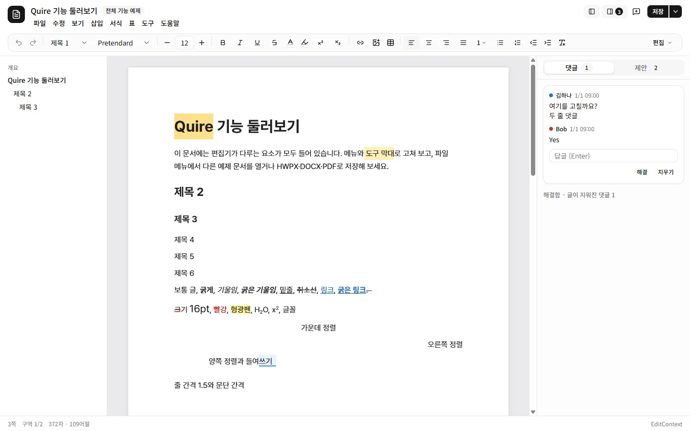
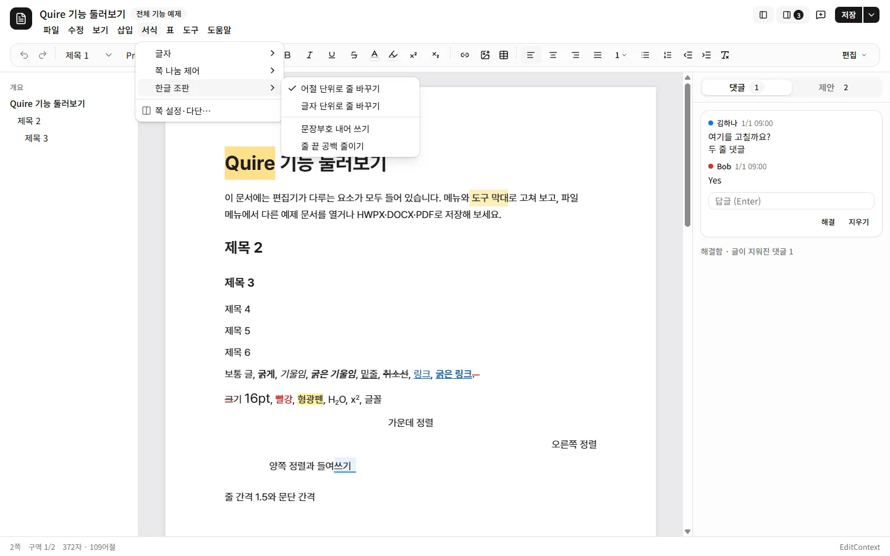
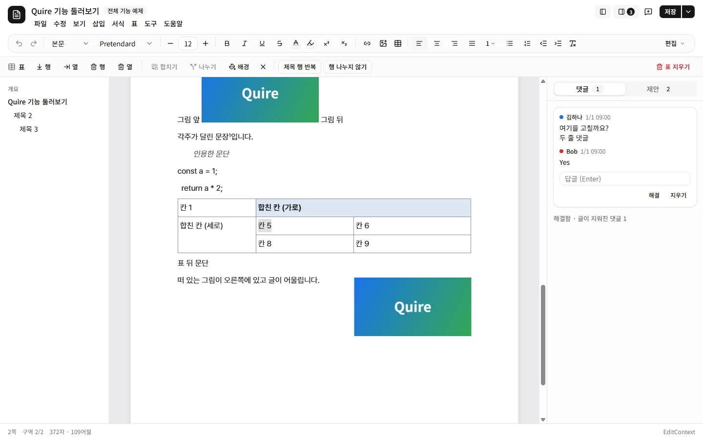
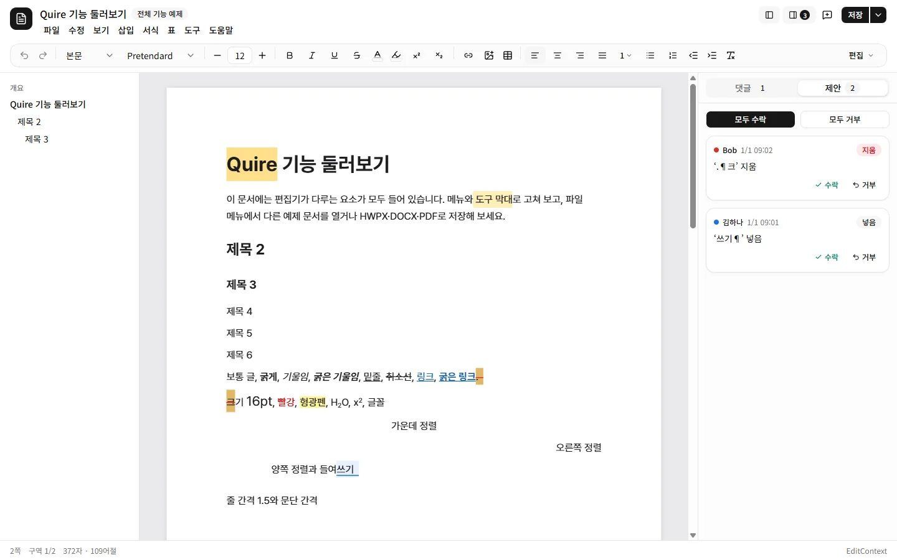
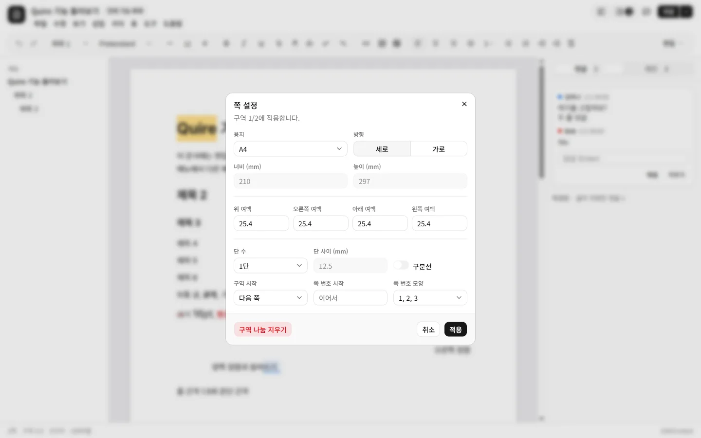
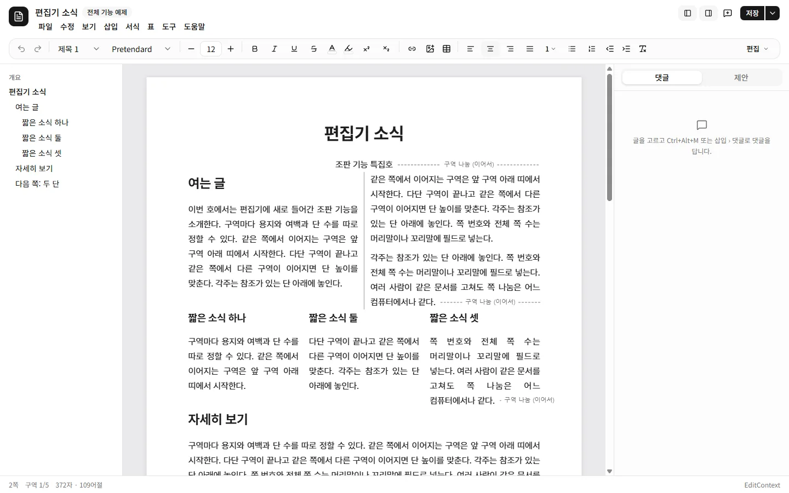
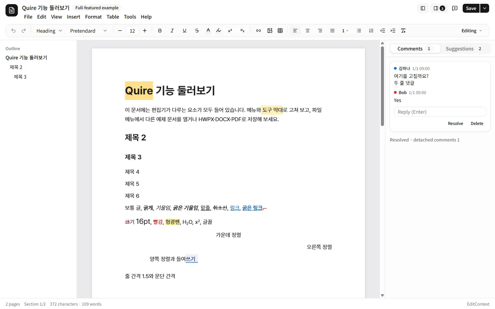

# 전체 기능 예제 · Next.js + Tailwind + shadcn/ui (Google Docs식)

Next.js 16 App Router에서 Quire 편집기의 기능을 모두 보여 주는 앱입니다. 화면은 [shadcn/ui](https://ui.shadcn.com) 컴포넌트만으로 만들었습니다 (Base UI판).
같은 기능을 Tailwind로 직접 만든 판은 [react-full](../react-full)입니다. 같은 편집기를 다른 스타일로 꾸민 예제: [Word식](../next-word) · [Notion식](../next-notion).



| | |
|---|---|
|  Menubar: 서식 › 한글 조판 |  표 안: 상황별 표 도구 줄 |
|  Tabs: 제안 수락·거부 |  Dialog: 쪽 설정 |
|  예제 문서 소식지: 구역마다 다른 다단 |  영어 화면 (보기 › 언어, `?lang=en`) |

## 실행

```bash
node scripts/build-packages.mjs   # 저장소 루트에서 먼저

cd examples/next-shadcn
npm install        # postinstall: 글꼴 조각, PDF용 WASM, 예제 문서를 public/quire에
npm run dev        # http://localhost:5307
```

기능은 [react-full](../react-full#담은-기능)과 같습니다: 메뉴 막대 8개, 도구 막대, 상황별 줄(표·그림·머리말/꼬리말·각주), 개요, 댓글·제안 창, 찾기·바꾸기, 쪽 설정, 오른쪽 클릭, 상태 줄, 저장 6형식.

## 언어 (한국어 · English)

화면 전체가 한국어·영어 두 벌입니다. 보기 › 언어에서 바꾸거나 `?lang=en`으로 열면 되고, 고른 언어는 브라우저에 기억합니다. 문서 내용은 바뀌지 않습니다.

- **메시지 표** ([`lib/messages.ts`](lib/messages.ts)): 앱 문구의 `ko`·`en`. `en`은 `Record<AppMessageKey, string>`이라 빠진 키가 타입 오류다.
- **편집기 메시지 장치에 덧붙이기** ([`lib/i18n.tsx`](lib/i18n.tsx)): `new Messages(locale, { ko, en })`(`@quiredoc/core`). 그래서 `t()`는 앱 키와 편집기 키(`attr.bold`, `section.nextPage`, `spell.addWord` 등)를 모두 알고, 자리표시·복수형(`{count, plural, one {# page} other {# pages}}`)도 같은 문법이다.
- **편집기도 같이**: 언어가 바뀌면 `editor.setLocale(locale)` — 캔버스 표시(나눔 표시 등), 제안 요약, 접근성 이름. 처음엔 `useQuire({ locale })`.
- 공통 코드([`lib/quire-app.ts`](lib/quire-app.ts))의 문구는 인자로 받는다: `documentTitle(h, t('app.untitled'))`, `checkPageForm(f, { negative, tooSmall })`.
- 가져오기 보고의 요소 이름("가로줄" 등)도 언어를 따른다 (편집기 메시지 `drop.*`, 설계 18 §9 L-5).

```tsx
const { t, locale, setLocale } = useI18n();
<MenubarRadioGroup value={locale} onValueChange={(v) => setLocale(v as Locale)}>…
<Item onSelect={a.newDoc}>{t('file.new')}</Item>
<span>{t('status.pages', { count: ui.pages })}</span>   // "2쪽" / "2 pages"
```

## 쓴 shadcn 컴포넌트

| 자리 | 컴포넌트 |
|---|---|
| 메뉴 막대 | `Menubar` (`MenubarSub`, `MenubarCheckboxItem`, `MenubarRadioGroup`, `MenubarShortcut`) |
| 도구 막대 | `Toggle`, `Button`, `Select`(스타일·글꼴), `Popover`(색·표 크기), `DropdownMenu`(줄 간격, 편집/제안 모드), `Tooltip` + `Kbd`, `Separator` |
| 상황별 줄 | `Toggle`(outline), `ToggleGroup`(그림 배치), `Button` |
| 옆 창 | `Tabs`, `ScrollArea`, `Badge`, `Textarea`, `Input` |
| 대화상자 | `Dialog`, `Select`, `Input`, `Label`, `Switch`, `ToggleGroup`(방향) |
| 그 밖 | `ContextMenu`(오른쪽 클릭, 맞춤법 고칠 말), `sonner`(저장·열기 알림), 저장 단추는 `Button` + `DropdownMenu` |

## 파일

| 파일 | 하는 일 |
|---|---|
| [`app/page.tsx`](app/page.tsx), [`app/EditorLoader.tsx`](app/EditorLoader.tsx) | 서버 컴포넌트는 틀만, 편집기는 `next/dynamic` `ssr: false` |
| [`app/layout.tsx`](app/layout.tsx) | `TooltipProvider`, `Toaster` |
| [`components/quire/QuireApp.tsx`](components/quire/QuireApp.tsx) | 전체 틀: `useQuire`·`QuireEditor`, `ContextMenu`, 대화상자, 저장·열기, 단축키 |
| [`components/quire/AppMenubar.tsx`](components/quire/AppMenubar.tsx) | 메뉴 막대 |
| [`components/quire/Toolbar.tsx`](components/quire/Toolbar.tsx) | 도구 막대 |
| [`components/quire/ContextBar.tsx`](components/quire/ContextBar.tsx) | 상황별 줄 |
| [`components/quire/Panels.tsx`](components/quire/Panels.tsx) | 개요, 댓글·제안 창, 찾기 카드, 상태 줄 |
| [`components/quire/Dialogs.tsx`](components/quire/Dialogs.tsx) | 쪽 설정, 링크·대체 텍스트, 알림형 대화상자 |
| [`components/ui/`](components/ui) | shadcn 컴포넌트 (CLI로 받음) |
| [`lib/quire-app.ts`](lib/quire-app.ts) | UI가 아닌 공통 코드 ([원본](../shared/quire-app.ts)) |
| [`lib/use-ui.ts`](lib/use-ui.ts) | `useUi`, `useAct` |
| [`lib/messages.ts`](lib/messages.ts), [`lib/i18n.tsx`](lib/i18n.tsx) | 앱 메시지 표(ko·en), `I18nProvider`·`useI18n`·`useT` |

## 핵심 코드

```tsx
// 메뉴에서 편집기 명령을 부른 뒤 포커스가 메뉴 단추로 돌아가지 않게: finalFocus={false}
<MenubarMenu>
  <MenubarTrigger>서식</MenubarTrigger>
  <MenubarContent finalFocus={false}>
    <MenubarCheckboxItem checked={!!ui?.marks.bold} onCheckedChange={() => act((e) => e.toggleMark('bold'))}>
      굵게 <MenubarShortcut>Ctrl+B</MenubarShortcut>
    </MenubarCheckboxItem>
  </MenubarContent>
</MenubarMenu>

// 오른쪽 클릭: 편집기는 맞춤법 메뉴·플러그인 항목만 알려 주고(false = 기본 동작을 막지 않음), 메뉴는 ContextMenu가 연다
const ctl = useQuire({ onContextMenu: (_e, spell, items) => (setCtx({ spell, items }), false) });

<ContextMenu>
  <ContextMenuTrigger render={<div className="relative flex-1" />}>
    <QuireEditor editor={ctl} className="h-full" />
  </ContextMenuTrigger>
  <ContextMenuContent finalFocus={false}>…</ContextMenuContent>
</ContextMenu>
```

## shadcn 설치에서 손본 것

- shadcn CLI 4는 기본으로 Base UI판(`base-nova`)을 깐다: `asChild` 대신 `render` 속성 (`<TooltipTrigger render={<Toggle … />} />`).
- CLI가 `cn`을 npm의 제3자 패키지 `cn`에서 가져오게 썼다. [`lib/utils.ts`](lib/utils.ts)를 표준(`clsx` + `tailwind-merge`)으로 고쳤다.
- `shadcn/tailwind.css`(애니메이션·`data-open:` 같은 변형)는 CLI 패키지를 의존성으로 두지 않으려고 [`app/shadcn.css`](app/shadcn.css)로 복사했다.
- init이 넣은 `next/font/google`의 Geist(라틴 글꼴)는 한국어 화면에 맞지 않아 빼고 한글 글꼴 목록을 쓴다.
- 컴포넌트를 더할 때: `npx shadcn@4.22.2 add <이름>` 뒤 `cn` 가져오기가 `@/lib/utils`인지 확인.

## 스크린샷 다시 찍기

```bash
node scripts/example-screenshots.mjs next-shadcn   # 저장소 루트에서 (헤드리스 Chrome)
```
