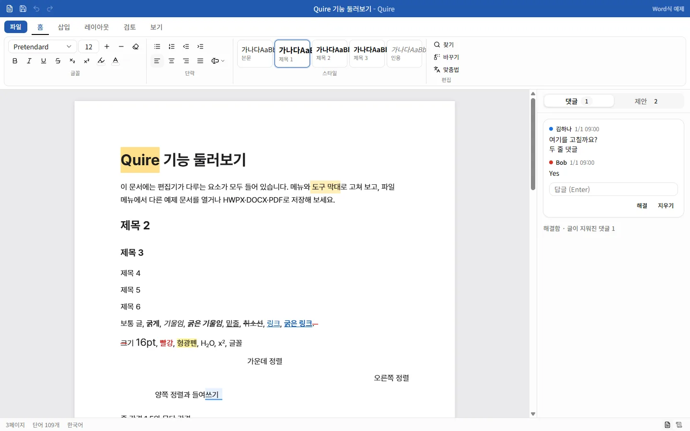
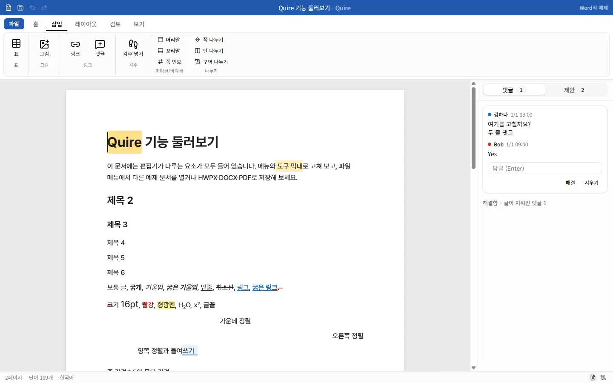
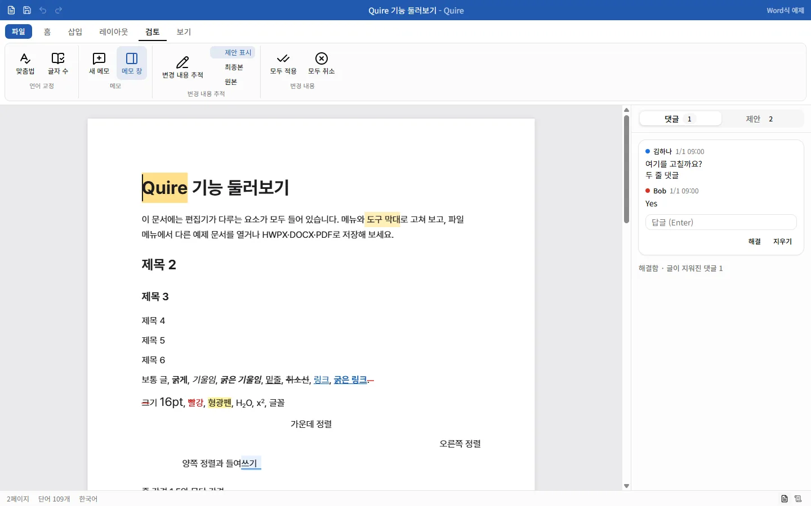
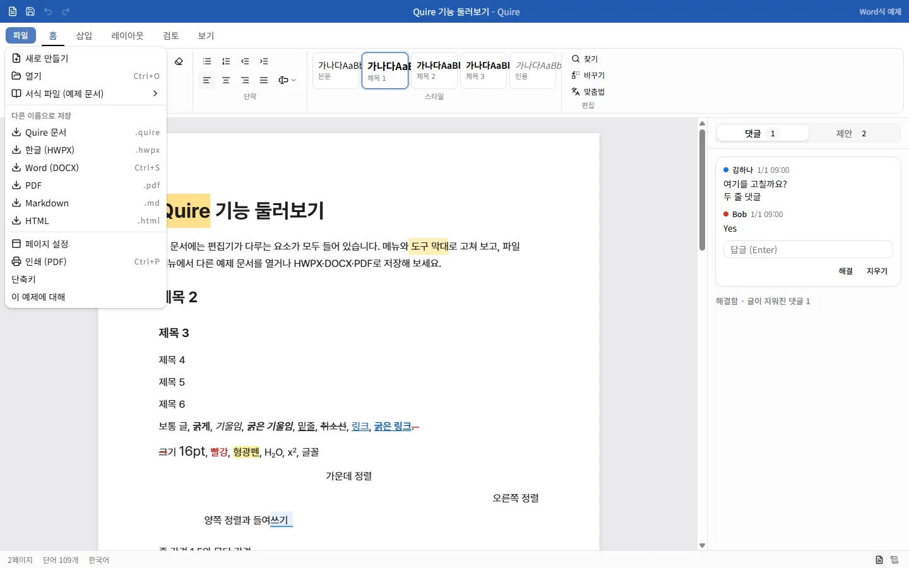

# 스타일 예제 · Word식 (Next.js + Tailwind + shadcn/ui)

같은 Quire 편집기를 Word식 화면으로 꾸민 예제입니다. 파란 제목 줄과 빠른 실행, 리본(홈·삽입·레이아웃·검토·보기), 인쇄 모양의 쪽, Word식 상태 줄.
같은 편집기로 만든 다른 스타일: [Google Docs식](../next-shadcn) · [Notion식](../next-notion).



| | |
|---|---|
|  삽입 탭 |  레이아웃 탭: 여백·용지 방향·크기·단 |
|  검토 탭: 변경 내용 추적(제안), 메모(댓글) |  파일 메뉴: 새로 만들기, 열기, 서식 파일, 다른 이름으로 저장 |

## 실행

```bash
node scripts/build-packages.mjs   # 저장소 루트에서 먼저

cd examples/next-word
npm install
npm run dev        # http://localhost:5308
```

## 리본

| 탭 | 그룹 |
|---|---|
| 홈 | 글꼴(글꼴·크기·굵게·기울임·밑줄·취소선·첨자·강조 색·글꼴 색·서식 지우기), 단락(목록·들여쓰기·맞춤·줄 간격), 스타일(갤러리), 편집(찾기·바꾸기·맞춤법) |
| 삽입 | 표(크기 고르기), 그림, 링크·댓글, 각주, 머리글/바닥글(머리말·꼬리말·쪽 번호), 나누기(쪽·단·구역) |
| 레이아웃 | 페이지 설정(여백 미리 정한 값·용지 방향·크기·단·페이지 설정 대화상자), 단락 쪽 나눔 제어, 한글 조판 |
| 검토 | 언어 교정(맞춤법·글자 수), 메모, 변경 내용 추적(제안 모드, 제안 표시·최종본·원본), 변경 내용 모두 적용·취소 |
| 보기 | 인쇄 모양·연속 보기(편집기 `setPageView`), 탐색 창·메모 창, 밝게·어둡게(편집기 `setColorScheme`) |

## 꾸미는 법

- 편집기: `useQuire({ theme: 'classic', pageView: 'print' })` — 회색 책상 위 그림자 있는 흰 쪽.
- 색: shadcn의 `--primary`를 Word 파랑으로 ([`app/globals.css`](app/globals.css)). 리본·제목 줄·눌린 단추가 모두 이 색을 쓴다.
- 리본: [`components/quire/Ribbon.tsx`](components/quire/Ribbon.tsx) — shadcn `Tabs`(밑줄형) + 그룹(큰 단추·작은 단추·그룹 이름).
- 그 밖(대화상자, 댓글 창, 찾기, 상황별 줄)은 [Google Docs식](../next-shadcn)과 같은 파일이다.

## 스크린샷 다시 찍기

```bash
node scripts/example-screenshots.mjs next-word
```
