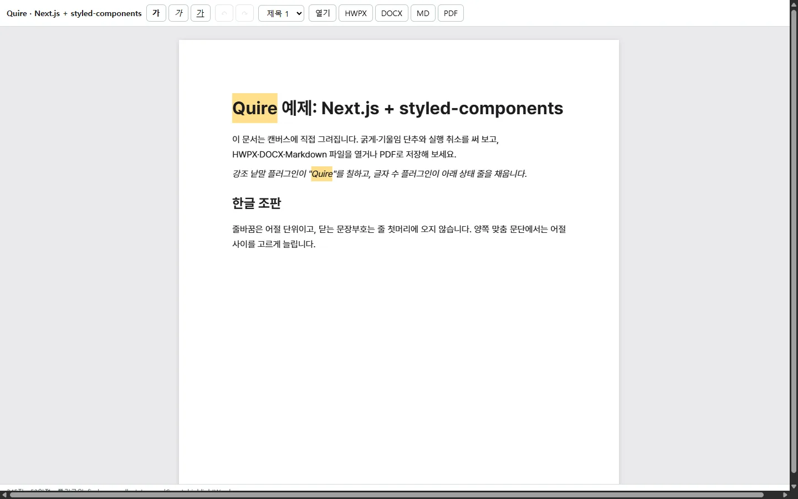

# Next.js + styled-components

Next.js 16 App Router에서 `@quiredoc/react`를 쓰는 예제입니다. 에디터는 브라우저에서만 만들고(`ssr: false`), 화면 틀과 styled-components 스타일은 서버에서 렌더링합니다.



## 실행

```bash
node scripts/build-packages.mjs   # 저장소 루트에서 먼저

cd examples/next
npm install
npm run dev                       # http://localhost:5303
```

## 파일

| 파일 | 하는 일 |
|---|---|
| [`app/page.tsx`](app/page.tsx) | 서버 컴포넌트: 틀만 그린다 |
| [`app/EditorLoader.tsx`](app/EditorLoader.tsx) | `next/dynamic`으로 편집기를 브라우저에서만 불러온다 |
| [`app/QuireApp.tsx`](app/QuireApp.tsx) | `useQuire`·`QuireEditor`와 styled-components 도구 막대 |
| [`lib/registry.tsx`](lib/registry.tsx) | styled-components 서버 렌더링 스타일 레지스트리 |
| [`next.config.mjs`](next.config.mjs) | Turbopack 별칭 (아래) |
| [`lib/quire-demo.ts`](lib/quire-demo.ts) | 예제 공통 ([원본](../shared/quire-demo.ts)) |

## 핵심 코드

```tsx
// app/EditorLoader.tsx — 캔버스·IME 코드는 서버에서 돌 필요가 없다
'use client';
import dynamic from 'next/dynamic';
const QuireApp = dynamic(() => import('./QuireApp'), { ssr: false });
export default function EditorLoader() {
  return <QuireApp />;
}
```

```js
// next.config.mjs — harfbuzzjs(Emscripten)는 Node에서만 import("module")을 부르는데,
// Turbopack은 브라우저 묶음에서도 그 모듈을 찾는다: 빈 모듈로 둔다
export default {
  compiler: { styledComponents: true },
  turbopack: { resolveAlias: { module: { browser: './lib/empty-module.js' } } },
  webpack: (config, { isServer }) => {
    if (!isServer) config.resolve.fallback = { ...config.resolve.fallback, module: false };
    return config;
  },
};
```

shadcn/ui로 만든 전체 기능 Next.js 앱은 [next-shadcn](../next-shadcn)을 보세요.
