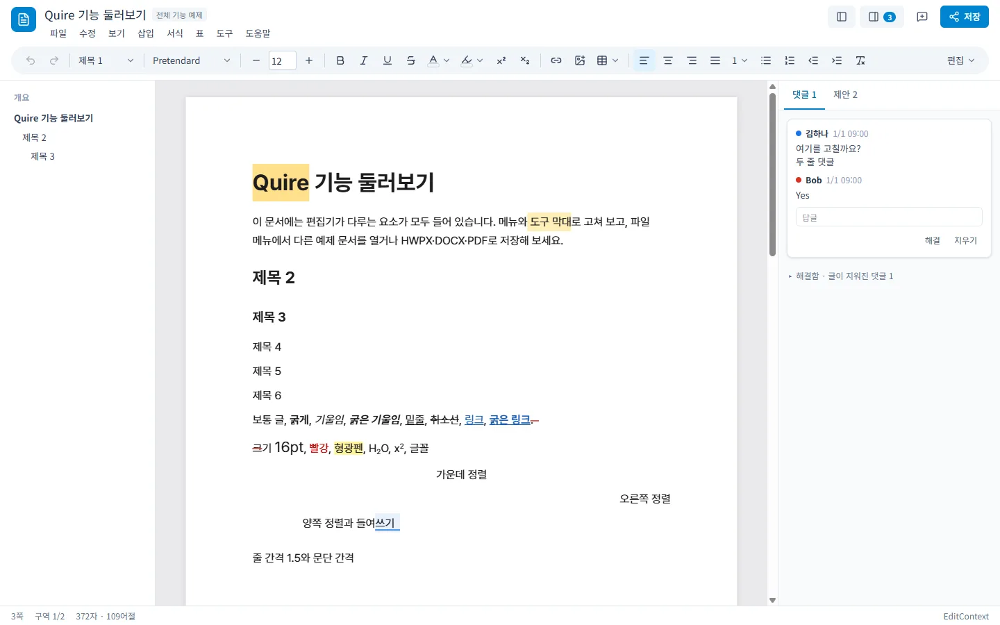
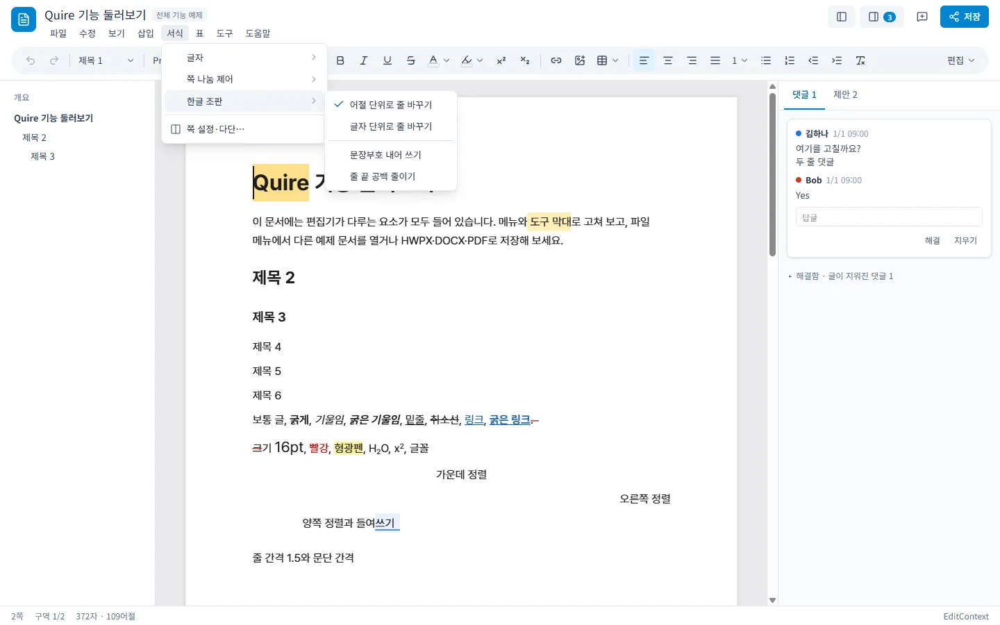
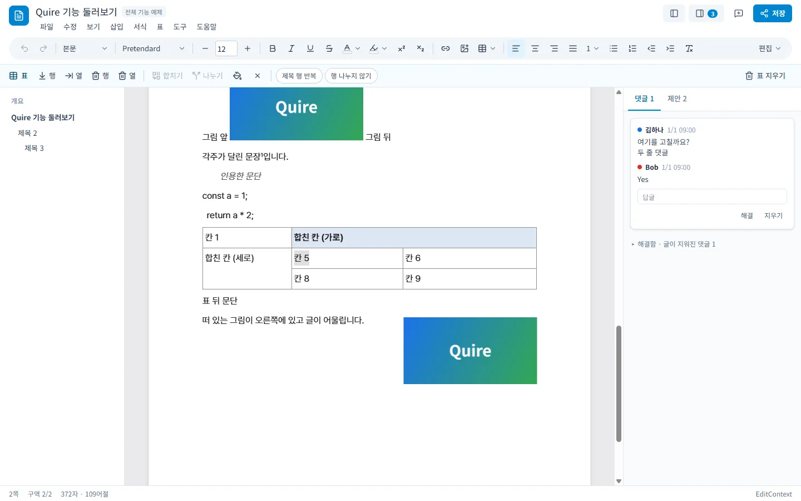
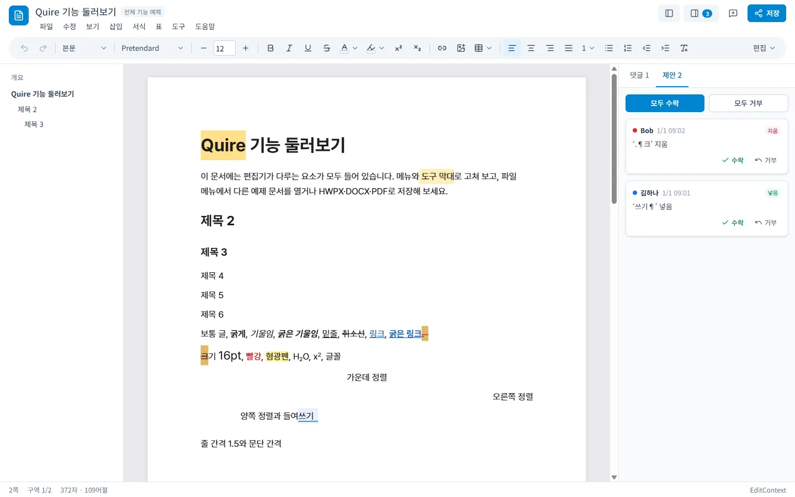
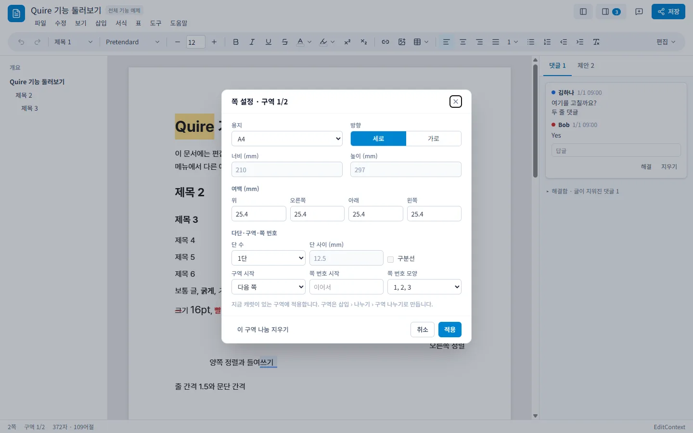
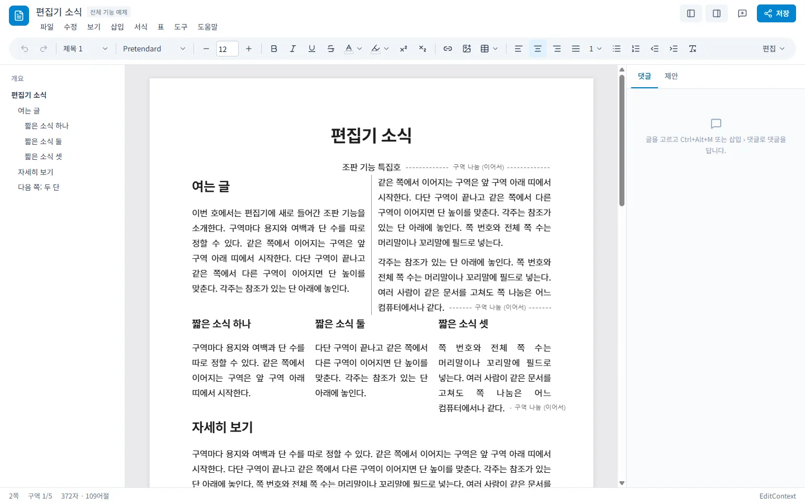

# 전체 기능 예제 · React + Vite + Tailwind

Word·Google Docs식 화면으로 Quire 편집기의 기능을 모두 보여 주는 React 앱입니다. 화면 조각은 Tailwind로 직접 만들었습니다.
같은 기능을 shadcn/ui로 만든 판은 [next-shadcn](../next-shadcn)입니다.



| | |
|---|---|
|  서식 › 한글 조판 메뉴 |  표 안: 상황별 표 도구 줄 |
|  제안 창: 수락·거부 |  쪽 설정 대화상자 |
|  예제 문서 소식지: 구역마다 다른 다단 | |

## 실행

```bash
node scripts/build-packages.mjs   # 저장소 루트에서 먼저

cd examples/react-full
npm install        # postinstall: 글꼴 조각, PDF용 WASM, 예제 문서(--samples)를 public/quire에
npm run dev        # http://localhost:5306
```

## 담은 기능

| 자리 | 기능 |
|---|---|
| 메뉴 막대 | **파일** 새 문서, 열기(.quire·HWPX·DOCX·Markdown·HTML), 예제 문서 7개, 내려받기 6형식, 쪽 설정, 인쇄(PDF) · **수정** 실행 취소, 찾기·바꾸기 · **보기** 개요·댓글 창, 제안 표시·최종본·원본 · **삽입** 그림, 표, 링크, 댓글, 각주, 쪽·단·구역 나누기, 머리말·꼬리말, 쪽 번호 필드 · **서식** 글자, 쪽 나눔 제어, 한글 조판, 쪽 설정·다단 · **표** 행·열 넣고 빼기, 합치기·나누기, 제목 행 반복, 행 나누지 않기 · **도구** 맞춤법, 글자 수, 제안 모드·모두 수락·거부, 강조 낱말 플러그인 · **도움말** 단축키 |
| 도구 막대 | 실행 취소, 스타일, 글꼴, 크기, 굵게·기울임·밑줄·취소선, 글자색·형광펜, 위·아래 첨자, 링크, 그림, 표(크기 고르기), 정렬, 줄 간격, 목록, 들여쓰기, 서식 지우기, 편집/제안 모드와 보기 |
| 상황별 줄 | 표 안, 그림을 고름(배치 5가지, 대체 텍스트), 머리말·꼬리말 편집(첫 쪽·홀짝·앞 구역과 연결, 필드), 각주 편집 |
| 옆 창 | 개요(제목 1–3, 눌러서 이동), 댓글(달기·답글·해결·지우기), 제안(수락·거부, 모두) |
| 그 밖 | 찾기·바꾸기(대소문자·낱말·정규식), 오른쪽 클릭(맞춤법 고칠 말, 댓글·링크, 플러그인 항목), 상태 줄, 단축키 Ctrl+S·P·O·Alt+M |

실시간 협업·버전 이력은 동기화 서버가 필요해 넣지 않았습니다.

## 파일

| 파일 | 하는 일 |
|---|---|
| [`src/App.tsx`](src/App.tsx) | 전체 틀: `useQuire`·`QuireEditor`, 대화상자 상태, 파일 열기·저장, 단축키 |
| [`src/lib/useUi.ts`](src/lib/useUi.ts) | `useUi`: 편집기 상태 알림마다 화면 상태를 읽음(같으면 다시 그리지 않음), `useAct`: 명령 후 편집기로 포커스 |
| [`src/lib/quire-app.ts`](src/lib/quire-app.ts) | UI가 아닌 공통 코드 ([원본](../shared/quire-app.ts)): 화면 상태 읽기, 개요, 쪽 설정 값, 모든 형식 열기·저장, 기능 둘러보기 문서, 예제 문서, 데모 맞춤법 검사기 |
| [`src/components/AppMenus.tsx`](src/components/AppMenus.tsx) | 메뉴 막대 |
| [`src/components/Toolbar.tsx`](src/components/Toolbar.tsx) | 도구 막대 |
| [`src/components/ContextBar.tsx`](src/components/ContextBar.tsx) | 상황별 줄 |
| [`src/components/Panels.tsx`](src/components/Panels.tsx) | 개요, 댓글·제안 창, 찾기 막대, 상태 줄 |
| [`src/components/Dialogs.tsx`](src/components/Dialogs.tsx) | 쪽 설정, 링크·대체 텍스트, 글자 수, 단축키, 알림, 오른쪽 클릭 메뉴 |
| [`src/components/ui.tsx`](src/components/ui.tsx) | 작은 UI 조각: 도구 단추, 내림 메뉴, 메뉴 막대, 대화상자 |

## 핵심 코드

```tsx
// 편집기 붙이기: 옵션은 처음 한 번만 쓰인다
const ctl = useQuire({
  fonts,
  plugins: [wordCountPlugin(setCount), highlightWordsPlugin(['Quire'])],
  onFindRequest: (replace) => setFind({ replace }),           // Ctrl+F·H를 앱의 찾기 막대로
  onContextMenu: (e, spell, items) => (setMenu({ x: e.clientX, y: e.clientY, spell, items }), true),
});

// 화면 상태: 서식·문단·표·개체·머리말·구역… (값이 같으면 같은 객체 → 다시 그리지 않음)
const ui = useUi(ctl);
// 명령: 편집기 API를 부르고 포커스를 편집기로 돌려준다
const act = useAct(ctl);

<ToolButton label="굵게" pressed={ui?.marks.bold} onClick={() => act((e) => e.toggleMark('bold'))}>…</ToolButton>
<QuireEditor editor={ctl} className="h-full" />
```

도구 막대 단추는 `onMouseDown`에서 기본 동작을 막아 편집기 포커스(와 IME 조합)를 빼앗지 않습니다.

## 스크린샷 다시 찍기

```bash
node scripts/example-screenshots.mjs react-full   # 저장소 루트에서 (헤드리스 Chrome)
```
