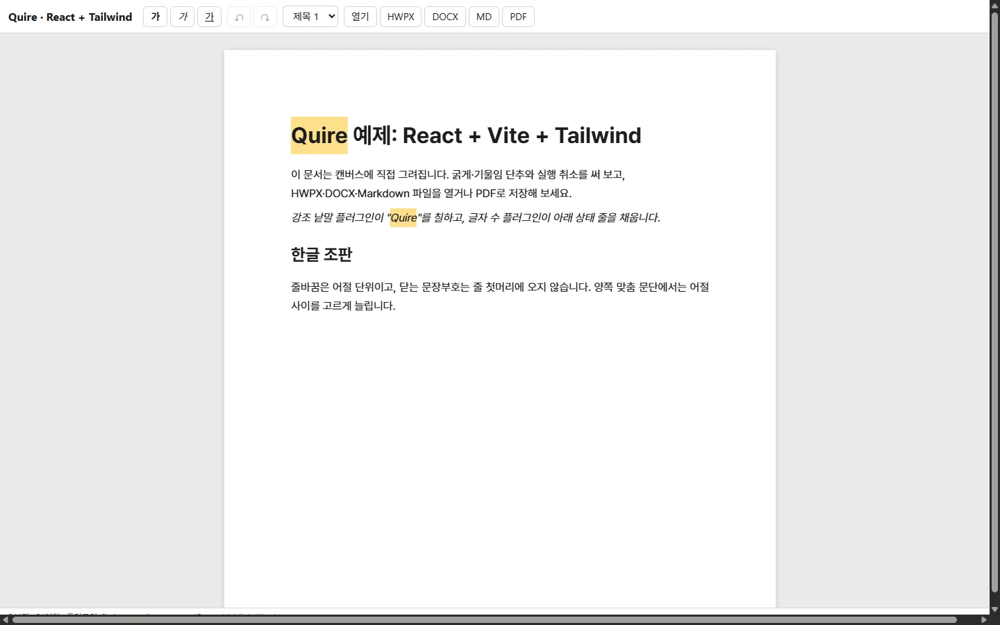

# React + Vite + Tailwind

`@quire/react`의 `useQuire`·`QuireEditor`·`useEditorState`로 붙이는 React 기본 예제입니다. Tailwind의 preflight(전역 리셋)를 켠 채로 편집기가 깨지지 않는지도 봅니다.



## 실행

```bash
node scripts/build-packages.mjs   # 저장소 루트에서 먼저

cd examples/react-vite
npm install
npm run dev                       # http://localhost:5302
```

## 파일

| 파일 | 하는 일 |
|---|---|
| [`src/App.tsx`](src/App.tsx) | 편집기와 Tailwind 도구 막대 |
| [`src/main.tsx`](src/main.tsx) | `StrictMode` (이중 마운트에서도 편집기가 한 번만 남는지) |
| [`src/index.css`](src/index.css) | `@import 'tailwindcss'` |
| [`src/quire-demo.ts`](src/quire-demo.ts) | 예제 공통 ([원본](../shared/quire-demo.ts)) |

## 핵심 코드

```tsx
import { QuireEditor, useEditorState, useQuire } from '@quire/react';

export function App() {
  // 처음 렌더의 옵션으로 한 번만 만든다 (옵션 객체가 매번 새로 만들어져도 그대로)
  const editor = useQuire({ doc: sampleDoc('React'), fonts, plugins: demoPlugins(setCount) });

  // 고른 값이 바뀔 때만 다시 그린다: 글자를 칠 때마다 도구 막대가 다시 그려지지 않는다
  const bold = useEditorState(editor, (s) => !!s.marksAtCaret.bold);
  const canUndo = useEditorState(editor, (s) => s.canUndo);

  return (
    <>
      <button aria-pressed={bold} onClick={() => editor.run('toggleBold')}>굵게</button>
      <button disabled={!canUndo} onClick={() => editor.run('undo')}>실행 취소</button>
      <QuireEditor editor={editor} className="flex-1" />
    </>
  );
}
```

메뉴·대화상자·댓글 창까지 갖춘 React 앱은 [react-full](../react-full)을 보세요.
