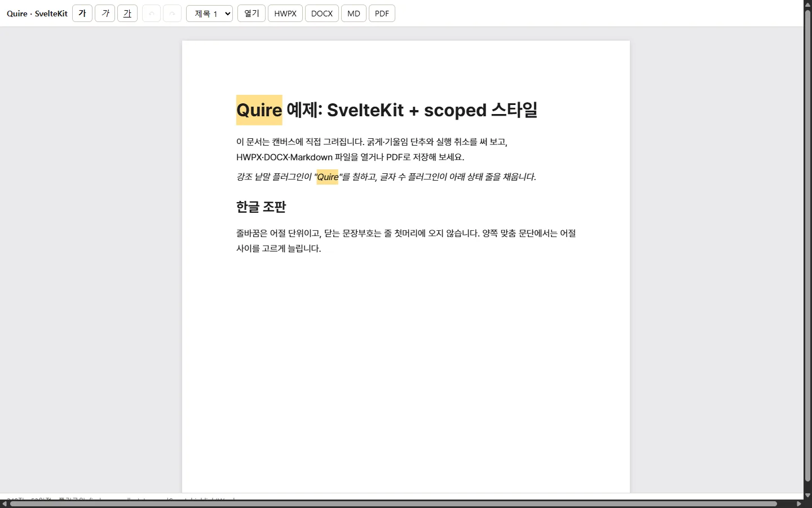

# SvelteKit + scoped 스타일

SvelteKit 3(Svelte 5)에서 공식 래퍼 없이 `@quiredoc/core`를 쓰는 예제입니다. 서버 렌더링 중에는 에디터를 만들지 않고, `onMount`에서 패키지를 동적으로 불러옵니다.



## 실행

```bash
node scripts/build-packages.mjs   # 저장소 루트에서 먼저

cd examples/svelte
npm install
npm run dev                       # http://localhost:5305
```

## 파일

| 파일 | 하는 일 |
|---|---|
| [`src/routes/+page.svelte`](src/routes/+page.svelte) | 편집기, 도구 막대, scoped 스타일 |
| [`src/routes/+layout.ts`](src/routes/+layout.ts) | 정적 사이트로 미리 렌더링 |
| [`vite.config.ts`](vite.config.ts) | SvelteKit 3 설정 (플러그인 옵션에) |
| [`src/lib/quire-demo.ts`](src/lib/quire-demo.ts) | 예제 공통 ([원본](../shared/quire-demo.ts)), `#lib/*`로 가져온다 |

## 핵심 코드

```svelte
<script lang="ts">
  import { onMount } from 'svelte';
  import type { EditorState, QuireHandle } from '@quiredoc/core';

  let host: HTMLElement;
  let handle = $state<QuireHandle | null>(null);
  let st = $state<EditorState | null>(null);

  onMount(() => {
    let alive = true;
    let h: QuireHandle | null = null;
    let off = () => {};
    // 에디터 패키지는 브라우저에서만 불러온다 (서버 묶음에 캔버스 코드를 넣지 않는다)
    import('@quiredoc/core').then(async ({ createEditor }) => {
      h = await createEditor({ host, doc: sampleDoc('SvelteKit'), fonts });
      if (!alive) return h.destroy();
      handle = h;
      st = h.getState();
      off = h.subscribe(() => (st = h!.getState()));
    });
    return () => {
      alive = false;
      off();
      h?.destroy();
    };
  });

  const run = (cmd: string) => {
    handle?.run(cmd);
    handle?.run('focus');
  };
</script>

<button aria-pressed={!!st?.marksAtCaret.bold} title="굵게" onclick={() => run('toggleBold')}><b>가</b></button>
<main bind:this={host} class="editor"></main>
```

## SvelteKit 3에서 달라진 것

- `svelte.config.js`를 읽지 않는다: 설정은 `sveltekit({ adapter: … })` 플러그인 옵션에.
- `$lib` 별칭이 없다: `package.json`의 `"imports": { "#lib/*": "./src/lib/*.ts" }`로 `#lib/quire-demo`.
- `tsconfig.json`은 `"extends": "$app/tsconfig"`.
