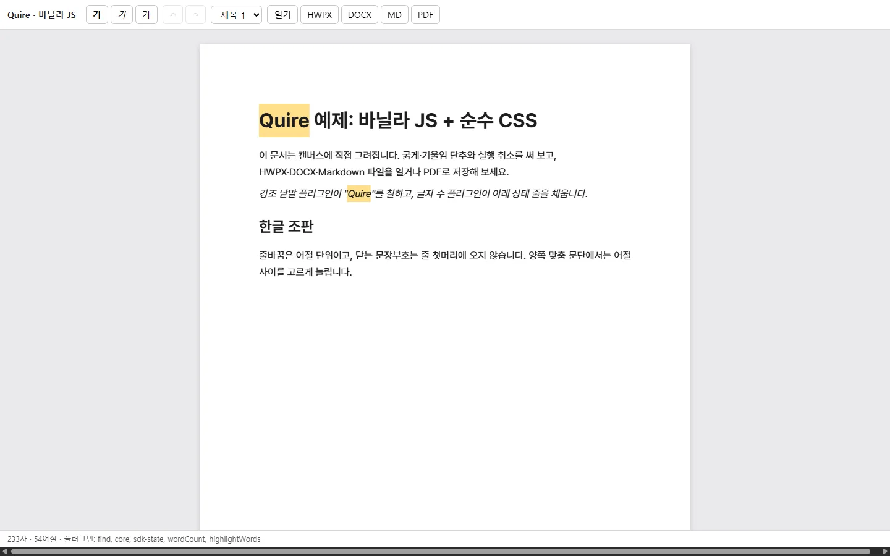

# 바닐라 JS + 순수 CSS

프레임워크 없이 `@quiredoc/core`의 `createEditor` 하나로 붙이는 가장 작은 예제입니다.



## 실행

```bash
# 저장소 루트에서 패키지를 먼저 빌드 (.build/packs)
node scripts/build-packages.mjs

cd examples/vanilla
npm install        # postinstall이 글꼴 조각·PDF용 WASM을 public/quire에 복사
npm run dev        # http://localhost:5301
```

## 파일

| 파일 | 하는 일 |
|---|---|
| [`index.html`](index.html) | 도구 막대(굵게·기울임·밑줄, 실행 취소, 스타일, 열기·저장)와 편집기 자리 |
| [`src/main.js`](src/main.js) | `createEditor`로 붙이고, `subscribe`로 도구 막대 상태를 맞춘다 |
| [`src/style.css`](src/style.css) | 순수 CSS |
| [`src/quire-demo.ts`](src/quire-demo.ts) | 예제 공통: 글꼴 위치, 처음 문서, 파일 열기·저장 ([원본](../shared/quire-demo.ts)) |
| [`vite.config.js`](vite.config.js) | `optimizeDeps.exclude: ['harfbuzzjs', 'loro-crdt']` |

## 핵심 코드

```js
import { createEditor } from '@quiredoc/core';

const editor = await createEditor({
  host: document.querySelector('#editor'),
  doc: sampleDoc('바닐라 JS + 순수 CSS'), // 정본(QuireDoc). 없으면 빈 문서
  fonts,                                   // 엔진 글꼴: /quire/fonts/의 조각 목록
  plugins: demoPlugins(onCount),           // 글자 수·강조 낱말 예제 플러그인
});

// 상태 스냅샷은 바뀔 때만 새 객체라, 같으면 다시 그리지 않아도 된다
editor.subscribe(() => {
  const s = editor.getState();
  boldButton.setAttribute('aria-pressed', String(!!s.marksAtCaret.bold));
});

boldButton.addEventListener('click', () => editor.run('toggleBold'));
```

## 이 예제가 보는 것

- 페이지 전역 CSS가 편집기(캔버스)를 깨지 않는지 (순수 CSS)
- 명령(`run`), 상태 구독(`getState`·`subscribe`), 파일 열기(`load`)·저장(`toJSON` → 변환)
- 전체 기능은 [react-full](../react-full)·[next-shadcn](../next-shadcn)을 보세요
