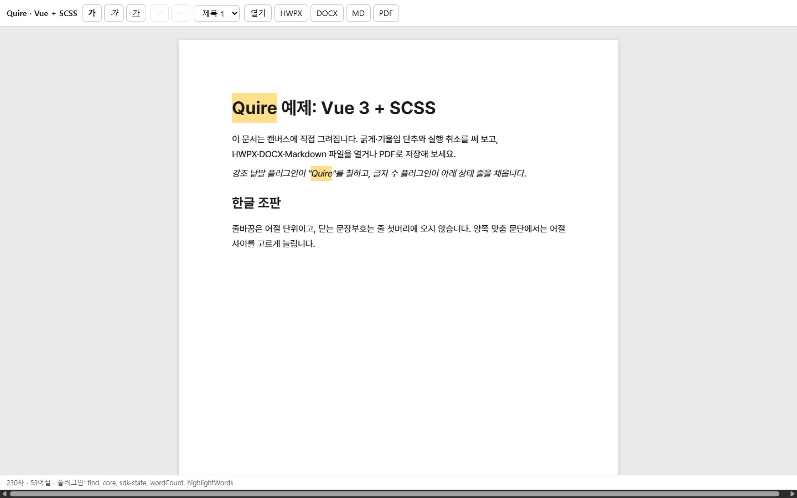

# Vue 3 + SCSS

공식 래퍼 없이 `@quiredoc/core`만으로 Vue에 붙이는 예제입니다. 수명주기를 묶는 작은 컴포저블 하나면 됩니다.



## 실행

```bash
node scripts/build-packages.mjs   # 저장소 루트에서 먼저

cd examples/vue
npm install
npm run dev                       # http://localhost:5304
```

## 파일

| 파일 | 하는 일 |
|---|---|
| [`src/useQuire.ts`](src/useQuire.ts) | 컴포저블: `onMounted`에서 만들고 `onBeforeUnmount`에서 정리, 상태는 `shallowRef` |
| [`src/App.vue`](src/App.vue) | 도구 막대와 편집기 자리 |
| [`src/styles.scss`](src/styles.scss) | SCSS (`@use 'sass:color'`) |
| [`src/quire-demo.ts`](src/quire-demo.ts) | 예제 공통 ([원본](../shared/quire-demo.ts)) |

## 핵심 코드

```ts
// src/useQuire.ts
import { onBeforeUnmount, onMounted, shallowRef, type Ref } from 'vue';
import { createEditor, type CreateEditorOptions, type EditorState, type QuireHandle } from '@quiredoc/core';

export function useQuire(host: Ref<HTMLElement | null>, options: Omit<CreateEditorOptions, 'host'>) {
  const handle = shallowRef<QuireHandle | null>(null);
  const state = shallowRef<EditorState | null>(null);
  let off: (() => void) | null = null;
  let alive = true;
  onMounted(async () => {
    const h = await createEditor({ ...options, host: host.value! });
    if (!alive) return h.destroy();
    handle.value = h;
    state.value = h.getState();
    // 스냅샷은 값이 같으면 같은 객체라 shallowRef가 바뀌지 않는다 (다시 그리지 않는다)
    off = h.subscribe(() => (state.value = h.getState()));
  });
  onBeforeUnmount(() => {
    alive = false;
    off?.();
    handle.value?.destroy();
  });
  return { handle, state };
}
```

```vue
<!-- src/App.vue -->
<button :aria-pressed="!!marks.bold" title="굵게" @click="run('toggleBold')"><b>가</b></button>
<main ref="host" class="editor"></main>
```
